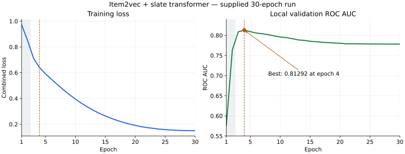

# Experiments and results

The current result comes from the complete `bash test.sh` console log supplied on 3 November 2026. Training was not rerun to create these docs. All 30 epoch records are preserved in [JSON](results/training-2026-11-03.json).

## Experiment progression

| Stage | What changed or was checked | Evidence and outcome |
|---|---|---|
| Randomly initialized transformer | 128-dimensional embeddings; two layers in each encoder | Earlier report described roughly 0.56 AUC. No complete baseline log is available here |
| Numerical stability | Empty-history placeholder, minimum mask length, non-finite loss guard, AUC loss weight 0.1 | Removed the fully masked history path; recorded transformed history lengths are nonzero in both splits |
| GPU execution and efficiency | CUDA required by default, explicit device output, batched pairwise loss, attention weights disabled | Model, candidate batch, and logits are reported on `cuda:0`; isolated loss benchmark is documented in [methods](methods.md#6-training-schedule-and-gpu-execution) |
| Simple diagnostic baselines | Popularity, user click overlap, own-history overlap, and context variability | Script is implemented; numeric diagnostic AUC output was not supplied. Cached data has four time buckets and two day types |
| Pretrained smaller transformer | Item2vec initialization; 64 dimensions; one layer per encoder; frozen item embeddings for two epochs; warmup/cosine schedule | **Best local validation AUC 0.81292 at epoch 4** in the supplied run |
| Rank blending | CLI support for combining the transformer with an existing GBDT score file | Available but no resulting blend score is recorded for this transformer |

Several changes were combined in the pretrained run. The improvement cannot be attributed to item2vec alone without controlled ablations that hold the other settings fixed.

## Recorded run

| Property | Value |
|---|---|
| GPU | NVIDIA GeForce RTX 4090 |
| Model size | Approximately 6.82M parameters |
| Vocabulary | 50,000 items; 54,456 users |
| Pretrained coverage | 49,974 item vectors out of 50,000 |
| Training / validation events | 583,790 / 103,034 |
| Temporal cutoff | 2025-01-25 23:14:00 UTC |
| Configuration | 64 dimensions; one layer per encoder; four heads; feed-forward width 256 |
| Optimization | AdamW; base LR `1e-3`; batch 512; 500-update warmup then cosine decay |
| Item embeddings | Frozen for epochs 1–2; unfrozen at epoch 3 |
| Best validation AUC | **0.81292, epoch 4** |
| Final validation AUC | 0.77834, epoch 30 |
| Best checkpoint | `best_model.pt`, selected by validation AUC |



The shaded band marks the frozen-item-embedding phase; the dashed line marks the best epoch.

The chart can be regenerated from the committed JSON with:

```bash
uv run --with matplotlib python docs/plot_training.py
```

## Interpretation

The first two epochs adapt the classifier with frozen item vectors. After unfreezing at epoch 3, validation AUC reaches 0.80884 and then peaks at 0.81292 in epoch 4. From epoch 4 to epoch 30, training loss falls from 0.6396 to 0.1497 while validation AUC falls to 0.77834. This pattern is consistent with overfitting after the early peak.

The training loop saves a checkpoint only when AUC improves. For this recorded run, prediction therefore uses epoch 4's weights, assuming the checkpoint has not subsequently been overwritten by another run. The model does not currently stop early; an early-stopping rule is a possible future change, not an implemented feature.

Reported epoch times range from 20.4 to 50.2 seconds. They exclude preparation and pretraining, and do not by themselves establish an end-to-end speedup over the previous implementation. The printed transformer nested-tensor warning concerns an unavailable optimization path with `norm_first=True`; the log also explicitly confirms CUDA tensors and completed GPU training.

## Full training history

| Epoch | Training loss | Validation AUC | Learning rate | Seconds |
|---:|---:|---:|---:|---:|
| 1 | 0.9737 | 0.57588 | 9.99e-04 | 20.8 |
| 2 | 0.8509 | 0.76376 | 9.93e-04 | 20.4 |
| 3 | 0.7125 | 0.80884 | 9.82e-04 | 32.3 |
| **4** | **0.6396** | **0.81292** | **9.65e-04** | **32.3** |
| 5 | 0.5911 | 0.80924 | 9.42e-04 | 32.5 |
| 6 | 0.5488 | 0.80574 | 9.15e-04 | 32.5 |
| 7 | 0.5077 | 0.80406 | 8.83e-04 | 34.4 |
| 8 | 0.4676 | 0.80171 | 8.47e-04 | 40.2 |
| 9 | 0.4295 | 0.79867 | 8.07e-04 | 35.9 |
| 10 | 0.3951 | 0.79584 | 7.63e-04 | 36.6 |
| 11 | 0.3633 | 0.79448 | 7.17e-04 | 34.3 |
| 12 | 0.3341 | 0.79186 | 6.68e-04 | 37.0 |
| 13 | 0.3081 | 0.78869 | 6.17e-04 | 35.0 |
| 14 | 0.2846 | 0.78753 | 5.65e-04 | 34.9 |
| 15 | 0.2639 | 0.78541 | 5.12e-04 | 38.0 |
| 16 | 0.2454 | 0.78415 | 4.59e-04 | 35.9 |
| 17 | 0.2293 | 0.78277 | 4.06e-04 | 35.7 |
| 18 | 0.2145 | 0.78196 | 3.55e-04 | 39.8 |
| 19 | 0.2018 | 0.78093 | 3.05e-04 | 33.0 |
| 20 | 0.1911 | 0.78050 | 2.57e-04 | 37.6 |
| 21 | 0.1812 | 0.77901 | 2.12e-04 | 37.5 |
| 22 | 0.1738 | 0.77915 | 1.70e-04 | 34.5 |
| 23 | 0.1681 | 0.77894 | 1.32e-04 | 43.2 |
| 24 | 0.1621 | 0.77859 | 9.85e-05 | 46.7 |
| 25 | 0.1583 | 0.77858 | 6.92e-05 | 47.8 |
| 26 | 0.1548 | 0.77850 | 4.47e-05 | 49.2 |
| 27 | 0.1528 | 0.77842 | 2.53e-05 | 47.1 |
| 28 | 0.1512 | 0.77837 | 1.14e-05 | 50.2 |
| 29 | 0.1504 | 0.77834 | 2.88e-06 | 43.4 |
| 30 | 0.1497 | 0.77834 | 3.13e-10 | 35.1 |

## What these results establish

This is a single local temporal validation run, with checkpoint selection using the same validation set. It does not include an official evaluation score, multiple training seeds, confidence intervals, or a controlled comparison against the source project's different validation cohorts.

Pretraining currently consumes histories from the full training and evaluation files, including snapshots beyond the supervised validation cutoff. It uses no click labels, but this is a transductive setup rather than a strictly isolated historical holdout. The supplied event histories are also used without additional filtering to enforce timestamps strictly before each event. A cutoff-restricted pretraining experiment and history timestamp audit are needed before claiming strictly causal validation performance.

Useful next experiments are a fixed-seed matched comparison with random versus pretrained vectors, early stopping or a shorter training budget, stronger regularization, and a held-out comparison of transformer-only versus tree/transformer blends. These are proposed follow-ups; no scores for them are claimed here.
